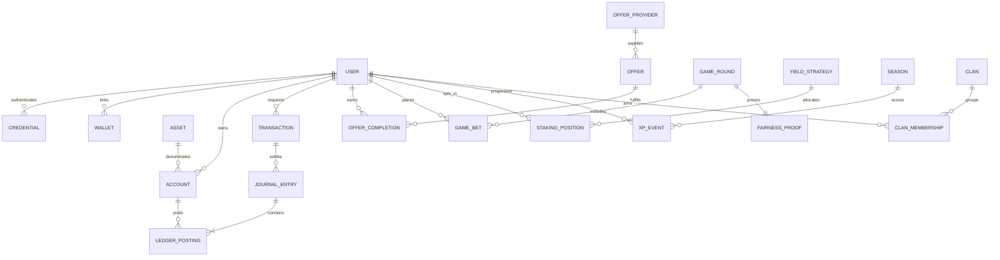

# Faucet Protocol

Plataforma en desarrollo de recompensas y herramientas cripto. La autenticación, el faucet de puntos internos y las tareas verificadas funcionan al conectar Supabase; las demás secciones financieras y ofertas de proveedores continúan en vista de demostración.

## Ejecutar

Requisitos: Node.js 20.19+ o 22.12+.

```bash
npm install
npm run dev
```

Verificaciones disponibles: `npm run build` y `npm run lint`. La build genera una PWA con manifest y service worker; en desarrollo el service worker no se registra.

## Conectar Supabase

1. Crea un proyecto en Supabase y configura `VITE_SUPABASE_URL` y `VITE_SUPABASE_PUBLISHABLE_KEY` (o la clave legacy `VITE_SUPABASE_ANON_KEY`) en `.env.local`, usando `.env.example` como referencia. `.env.local` está ignorado por Git.
2. Ejecuta en orden `supabase/migrations/202610100001_profiles.sql`, `supabase/migrations/202610100002_daily_faucet.sql`, `supabase/migrations/202610100003_earn_tasks.sql` y `supabase/migrations/202610100004_offerwall_callbacks.sql` y `supabase/migrations/202610120005_referrals.sql` en el SQL Editor del proyecto. La última migración prepara la tabla privada e idempotente de completaciones externas y una función de crédito que solo puede ejecutar `service_role`; no activa ningún proveedor ni acepta llamadas desde el navegador.
3. En Supabase, habilita el proveedor Email en **Authentication → Providers** y configura las URLs de sitio/redirección para el origen local (`http://localhost:5173`) y el dominio de producción.
4. Reinicia Vite. El indicador del pie de página consulta `profiles` y distingue conexión, migración pendiente y credenciales sin configurar.

### Correo de confirmación

El SMTP predeterminado de Supabase es solo para pruebas: solo envía a direcciones del equipo del proyecto y tiene un límite reducido. Para entregar correo a usuarios, configura un proveedor SMTP propio en **Authentication → SMTP Settings**. No agregues usuarios de la aplicación como miembros del equipo de Supabase para eludir esta restricción, ya que eso les concede acceso al proyecto.

## Depósitos por QR

El dashboard no requiere conectar una wallet para depositar. La vista de depósitos por QR está diseñada, pero permanece deshabilitada hasta integrar un proveedor que genere direcciones únicas por cuenta, detecte confirmaciones y acredite fondos en el servidor. No configures una dirección compartida estática ni envíes fondos a direcciones de prueba: sin esa integración no se pueden identificar ni acreditar depósitos.

El cliente está en `src/lib/supabase.ts`. La home ya ofrece registro con email/contraseña, login, restablecimiento/cambio de contraseña, persistencia de sesión y cierre de sesión. Si el proveedor Email exige confirmación, el registro informa que debe confirmarse desde el correo. Solo se admite la clave pública publishable/anon en Vite; **nunca** pongas la `service_role` key en variables `VITE_*` ni en el navegador.

## Preparación para un proveedor de offerwall

La app no tiene un proveedor seleccionado ni una cuenta publisher aprobada. No hay ofertas externas activas: el área de Earn las identifica como no conectadas y no muestra pagos estimados. Antes de solicitar o activar ofertas, prepara el dominio de producción, datos de contacto de soporte, política de privacidad y términos reales del operador; explica que el saldo actual son puntos internos sin valor monetario y que no se ofrecen retiros cripto.

La base de datos y `supabase/functions/offerwall-callback` contienen una base genérica para recibir una notificación firmada, comprobar su antigüedad, validar los campos, y acreditar puntos una sola vez por `(provider, external_transaction_id)`. El callback de referencia requiere `POST` JSON con `provider`, `external_transaction_id`, `user_id` y `points`, los headers `x-faucet-timestamp` (Unix en segundos) y `x-faucet-signature` (HMAC-SHA256 hexadecimal del texto exacto `${timestamp}.${body}`), y los secretos server-side `OFFERWALL_PROVIDER_ID` y `OFFERWALL_WEBHOOK_SECRET` (este último: valor aleatorio de 32 bytes hexadecimales). Rechaza firmas vencidas después de cinco minutos. La migración correspondiente debe ejecutarse antes de desplegar la función.

**Esta base no es todavía una integración con Lootably ni con otro proveedor.** El formato real de firma, los campos de identificador de usuario/transacción, la conversión aprobada a puntos, reversos/cancelaciones, límites, y respuestas HTTP esperadas dependen del contrato y documentación del proveedor que se seleccione. No se debe publicar ni registrar un callback en el panel del proveedor hasta implementar y probar ese adaptador concreto. No aceptes importes o puntos indicados por el navegador; los secretos de callback y `service_role` solo deben estar en secretos server-side de Supabase. Prueba primero con eventos de sandbox y transacciones repetidas, negativas, mal firmadas y caducadas.

## Estado del producto

- **Home:** portada de producto con accesos a wallet, Earn/faucets, juegos, mercados, anuncios y cuenta. Las áreas sin integración se identifican como demostración y no mueven fondos.
- **Dashboard (`/dashboard`):** navegación por Resumen, Mercados, Cartera, depósitos, retiros, transferencias, exchange, historial, direcciones, Faucets, Offerwalls, Shortlinks, PTC, Juegos, Lotería, Staking, Afiliados, campañas, listings patrocinados, API, Perfil, Seguridad y Ajustes; incluye además Social-Fi. Login exitoso abre esta ruta. Las opciones muestran previews/demo hasta conectar los servicios correspondientes.
- **Seguridad de cuenta:** el usuario puede registrar una app autenticadora TOTP desde Seguridad; el dashboard solicita el código en los inicios de sesión posteriores cuando Supabase eleva el nivel de autenticación a AAL2. La pantalla permite generar códigos de recuperación de un solo uso tras volver a verificar TOTP y usarlos como alternativa al iniciar sesión; Supabase Auth del proyecto debe soportar y tener habilitada esta función experimental. Los códigos solo se muestran una vez y no se guardan en las tablas públicas de la aplicación.
- **Cartera e historial de puntos:** Cartera presenta el saldo promocional real de Supabase separado de las monedas demo; Historial muestra las acreditaciones del ledger de recompensas con fecha, origen y balance posterior.
- **Depósitos:** el acceso por QR no requiere conectar una wallet, pero permanece deshabilitado hasta añadir generación de direcciones únicas y acreditación segura server-side.
- **Afiliados:** cada cuenta tiene un enlace `/?ref=CODIGO`. La persona invitada lo aplica automáticamente en su primer acceso (solo durante los primeros 7 días de la cuenta); cuando completa la tarea de perfil, el referidor recibe 15 puntos internos, con tope de 20 referidos recompensados. La lógica vive en funciones `security definer` de la migración 5; el navegador no puede acreditar puntos. La migración aún no se ha probado contra una base Postgres real: ejecútala primero en un proyecto de pruebas.
- **Actividad del resumen:** el mapa de actividad y los puntos del mes se calculan desde el ledger real de recompensas.
- **Temporada y XP:** el nivel y las misiones se calculan en el cliente desde el ledger real (1 punto = 1 XP, 100 XP por nivel, temporada = mes natural). Las misiones (faucet 7 días, perfil, referido, oferta) solo muestran progreso y no otorgan XP ni puntos adicionales. Gremio sigue siendo un ejemplo de demostración sin backend.
- **Diseño y movimiento:** tipografías autoalojadas (Inter Variable, Sora Variable, JetBrains Mono vía `@fontsource`), parallax por scroll y ratón, revelados con IntersectionObserver, tarjetas con spotlight/tilt y contadores animados (`src/lib/motion.ts`, `src/components/CountUp.tsx`). Todo respeta `prefers-reduced-motion`.
- **Resumen del dashboard:** el panel de recompensas carga el saldo real de puntos internos y enlaza únicamente con el faucet y la tarea de perfil actualmente habilitados; ya no muestra importes USD ni ofertas ficticias como recompensas disponibles.
- **Recompensas y tareas internas:** con Supabase y sesión iniciada, cada usuario puede reclamar 10 puntos cada 24 horas y una recompensa única de 25 puntos por verificar el correo y completar su nombre visible. El servidor valida los requisitos y acredita los puntos en la misma transacción que registra la tarea y una entrada de ledger inmutable. RLS limita la lectura al propietario; las tablas no permiten acreditar ni editar recompensas desde el navegador. Los puntos no son criptoactivos, no tienen valor monetario y no se pueden retirar ni transferir.
- **Datos reales de mercado:** mini-gráfico BTC/USDT y cotizaciones BTC, ETH, SOL y DOGE vía Binance Spot. El explorador completo de pares permanece en `src/MarketExplorer.tsx`, pero no está conectado a la home.
- **Pendiente para producción completa:** confirmar/habilitar el soporte de códigos de recuperación MFA en el servidor Supabase del proyecto; aprobación del publisher y adaptación del callback a la documentación/contrato del proveedor; política de privacidad, términos y contacto operativos revisados; conversión de puntos, reversos, controles de fraude, monitorización y pruebas del proveedor; ledger de doble entrada para activos, custodia, depósitos/retiros, wallet connect para uso de fondos, swap, juegos con dinero y operaciones de backend. Las ofertas externas no se habilitan hasta concluir esos pasos.
- **Límite de seguridad:** no conectar fondos reales a esta UI. Antes hacen falta servicios, revisión legal, auditorías, controles operativos y conciliación.

La home consulta endpoints públicos de Binance Spot (`/api/v3/ticker/24hr`, `/api/v3/klines`) y su WebSocket de velas. Los precios se refrescan cada 30 segundos; si el stream falla, el gráfico usa sondeo REST cada 15 segundos. El explorador separado carga los pares públicos y permite filtros. Las APIs pueden limitar tráfico o no estar disponibles en ciertas regiones. Para producción, mover estas consultas a un adaptador backend con caché, límites, monitorización y proveedor alternativo; validar los términos del proveedor.

## Arquitectura objetivo

| Dominio | Tecnología y responsabilidad |
|---|---|
| Cliente | Next.js/React + TypeScript; PWA, panel responsive y rutas autenticadas. La demo actual usa Vite para iterar el frontend sin fingir SSR ni servicios. |
| API | NestJS modular; REST versionado para comandos/consultas y WebSocket para cotizaciones y notificaciones. OpenAPI como contrato. |
| Identidad | Email/passkeys y 2FA; OIDC opcional. WalletConnect para EVM y adaptador separado para Solana. Abstracción de cuentas por cadena/proveedor. |
| Ledger | PostgreSQL; doble entrada append-only, transacciones ACID, idempotencia, cuentas disponibles/pendientes/reservadas y conciliación. Nunca usar `float` para importes. |
| Procesamiento | Redis para caché y rate limiting; Kafka/RabbitMQ para callbacks, retiros y eventos. Outbox transaccional para no perder eventos. |
| Analítica | ClickHouse/warehouse aislado del OLTP para cohortes, ROI, campañas y fraude. |
| Custodia | Proveedor institucional o MPC/HSM con políticas de firma, límites, allowlists y aprobación reforzada. Claves fuera de la aplicación y de PostgreSQL. |
| Web3 | Contratos Solidity en una red EVM inicial. Añadir Solana solo con un caso validado. Auditoría independiente antes de custodiar o distribuir activos. |
| Operación | Infraestructura como código, secretos en KMS, métricas/trazas con OpenTelemetry, alertas y runbooks de incidentes. |

Mantener un **monolito modular** inicialmente. Separar workers o servicios cuando el volumen, aislamiento de riesgo o equipos lo justifiquen. Adaptadores desacoplados para custodios, redes, precios, proveedores Earn, ad networks y protocolos DeFi.

### Dominios de aplicación

`Identity`, `Accounts/Ledger`, `Custody`, `Earn`, `Ads`, `Swap`, `Games`, `Risk`, `Rewards/Social`, `Developer API` y `Notifications`. Los comandos financieros deben validar límites y riesgo, registrar asientos atómicos y publicar eventos mediante outbox.

### Modelo de datos inicial



Entidades mínimas: `User`, `Credential`, `Wallet`, `Asset(chain, contract, decimals)`, `Account(user, asset, purpose)`, `JournalEntry`, `LedgerPosting(account, side, amount_minor)`, `Transaction`, `WithdrawalRequest`, `Offer`, `OfferProvider`, `OfferCompletion`, `AdCampaign`, `Impression/Click/Conversion`, `GameRound`, `GameBet`, `FairnessProof`, `SwapQuote/Execution`, `YieldStrategy`, `StakingPosition`, `XPEvent`, `Season`, `Clan`, `ClanMembership`, `RiskEvent`, `ReviewCase` y `AuditLog`.

Invariantes: importes en unidades mínimas enteras; asiento balanceado por activo; claves idempotentes únicas por operación/proveedor; callbacks firmados y deduplicados; ledger inmutable con reversos compensatorios; separar saldo disponible, retenido y pendiente; registrar hash/red/proveedor y estados auditables. Datos de identidad separados de señales antifraude, con retención limitada y acceso mínimo.

## Modelo de negocio y token

Ingresos principales: comisión neta de proveedores Earn, margen explícito de la red publicitaria, tarifas transparentes de swap, planes B2B/API y funciones premium. No basar la economía en pérdidas de jugadores, emisión perpetua o rendimiento prometido.

Utilidades candidatas del token: descuento verificable en tarifas, herramientas premium para anunciantes/desarrolladores y recompensas de temporada limitadas por presupuesto. No debe ser obligatorio para depositar o retirar. Evitar prometer “dividendos”: compartir ingresos con holders puede convertirlo en valor regulado según jurisdicción.

Política deflacionaria, condicionada a revisión legal y de mercado:

1. Publicar suministro, asignaciones, vesting, tesorería, emisiones, quemas y obligaciones. Recompensas financiadas por ingresos netos realizados, con límites por temporada.
2. Destinar, por ejemplo, hasta el 20% de **comisiones netas cobradas** de anuncios y swaps a recompras/quema trimestral, sujeto a solvencia, liquidez y aprobación de gobernanza. Es un parámetro de diseño para probar, no una promesa de precio.
3. En juegos, cobrar solo una tarifa de servicio explícita y legal; separar apuestas, premios y comisiones. Nunca financiar la quema con fondos del jugador ni incentivar pérdidas.
4. El staking DeFi es opt-in, con protocolos, redes, comisiones, liquidez y riesgos divulgados. Mostrar tasas históricas, nunca garantizadas; mantener reservas para pasivos y no invertir automáticamente micropagos.

## Roadmap y puertas de salida

### Fase 1 · MVP

Ledger y conciliación; autenticación segura; un custodio y pocas redes/activos; depósitos/retiros con límites; catálogo Earn con un proveedor, callbacks idempotentes y panel de soporte. Añadir referidos limitados, historial, estado de operaciones y analítica básica. Sin token, casino real ni yield.

**Gate:** conciliación diaria sin diferencias, retiros reproducibles, callbacks idempotentes, plan de incidentes probado, fraude dentro del presupuesto y coste por usuario retenido medido.

### Fase 2 · Ecosistema

Integrar proveedores adicionales, PTC/ad network, campañas y API de pagos con sandbox, scopes, rotación de claves, cuotas y webhooks firmados. Lanzar XP, pase gratuito y gremios con recompensas presupuestadas; dashboard de actividad y ROI de referidos. Activar swap solo con cotizaciones, liquidez y slippage auditables. Riesgo primero por reglas explicables; ML en modo sombra antes de influir en bloqueos.

**Gate:** margen de contribución positivo por cohorte, soporte y moderación escalables, controles de tráfico inválido, políticas de privacidad y acuerdos con proveedores revisados.

### Fase 3 · Web3

WalletConnect/smart accounts, contratos auditados, prueba de reservas y pasivos con metodología publicada, estrategia DeFi opt-in limitada y gobernanza gradual. Provably fair con algoritmo y pruebas verificables. Dinero real en juegos solo con licencias, controles de edad, geobloqueo, límites y juego responsable. La prueba de reservas aislada no demuestra solvencia.

## Go-to-market

1. Empezar en comunidades de faucets y micro-recompensas de una o dos redes de bajo coste. Lanzar cohortes por invitación y comunicar límites, comisiones y tiempos de retiro.
2. Alcanzar los primeros 10.000 con creadores y comunidades, guías comparativas y referidos pagados por actividad válida, no por registro/clic. Medir activación, retención D7/D30, coste por usuario retenido y margen por cohorte.
3. Captar operadores con API/sandbox, importación asistida, atribución, pagos automáticos, panel antifraude y reparto de ingresos transparente. Pilotos temporales sin exclusividad; migración siempre voluntaria.
4. Publicar página de estado, incidentes, reglas de ofertas, pruebas de fairness, reservas/metodología y soporte. No extraer listas de usuarios ni anunciar “sin comisiones” si el coste se recupera por otra vía.

## Seguridad y cumplimiento

Custodia, transmisión de dinero, KYC/AML, privacidad, token, publicidad y juego dependen de la jurisdicción. Obtener asesoría antes de habilitar cada flujo. No usar VPN como criterio único de bloqueo: combinar señales explicables, revisión humana y apelación. Aplicar controles de edad/territorio cuando correspondan, minimización de datos, límites de retiro, sanciones de proveedores y auditorías de contratos.
# React + TypeScript + Vite

This template provides a minimal setup to get React working in Vite with HMR and some Oxlint rules.

Currently, two official plugins are available:

- [@vitejs/plugin-react](https://github.com/vitejs/vite-plugin-react/blob/main/packages/plugin-react) uses [Oxc](https://oxc.rs)
- [@vitejs/plugin-react-swc](https://github.com/vitejs/vite-plugin-react/blob/main/packages/plugin-react-swc) uses [SWC](https://swc.rs/)

## React Compiler

The React Compiler is not enabled on this template because of its impact on dev & build performances. To add it, see [this documentation](https://react.dev/learn/react-compiler/installation).

## Expanding the Oxlint configuration

If you are developing a production application, we recommend enabling type-aware lint rules by installing `oxlint-tsgolint` and editing `.oxlintrc.json`:

```json
{
  "$schema": "./node_modules/oxlint/configuration_schema.json",
  "plugins": ["react", "typescript", "oxc"],
  "options": {
    "typeAware": true
  },
  "rules": {
    "react/rules-of-hooks": "error",
    "react/only-export-components": ["warn", { "allowConstantExport": true }]
  }
}
```

See the [Oxlint rules documentation](https://oxc.rs/docs/guide/usage/linter/rules) for the full list of rules and categories.
